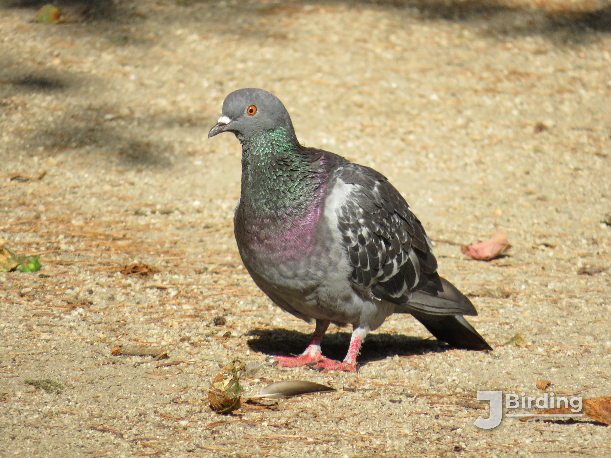

La especie de paloma más común y fácil de ver a lo largo del mundo, la paloma bravía presenta la forma característica de las palomas: cabeza pequeña, cuerpo rechoncho, patas robustas.

Mide unos 33 cm de pico a cola, siendo algo más pequeña que la paloma torcaz.
Los ejemplares más típicos presentan un plumaje gris claro más o menos uniforme, con dos franjas negras en las alas y la punta de las alas de color oscuro.
Destaca la iridiscencia morada y verde del cuello, extendiéndose por delante y detrás, llegando hasta parte del pecho y del dorso.

*Columba livia*

Es fácilmente confundible por aspecto con la paloma zurita (*Columba oenas*){note2}. Sin embargo, esta segunda es algo más pequeña, tiene menos iridiscencia en el cuello, y presenta ojos completamente oscuros, en contraste con los ojos naranjas de la paloma bravía.

La paloma bravía moderna es, en su mayoría, descendiente de la paloma doméstica.
Casi no quedan palomas bravías silvestres: en su lugar, la mayoría son descendientes de palomas domésticas liberadas o híbridos de estas con silvestres (ejemplares semisilvestres).
Esto es algo inusual en las aves y tiene varias consecuencias.

Una paloma con leucismo parcial.

Respecto a su apariencia, las palomas domésticas son objeto de la selección artificial, acelerando y exagerando ciertas características.
Por ello, las palomas bravías semisilvestres o asilvestradas presentan muchas más variciones en su plumaje que otras especies.
Son comunes palomas marrones o complementamente oscuras o blancas, a diferencia del gris típico.
Además, el leucismo{note1} es muy común en esta especie, más que en otras.
También, pero con menos frecuencia, se pueden encontrar otras variaciones genéticas, como plumas en las patas.

Por otra parte, el pasado doméstico de esta especie también influye en su hábitat moderno.
Hoy en día, la paloma bravía se distribuye a lo largo de todo el mundo, con pocas excepciones, y vive principalmente en entornos urbanos.
Uno de los motivos es la similaridad entre su hábitat natural de acantilados rocosos y los edificios de pueblos y ciudades.
Sin embargo, su domesticación es el principal factor.
Los escapes y las liberaciones de ejemplares en cautiverio son el principal motor de expansión de la especie, y su afinidad por los humanos (derivada de la domesticación) hace que se establezca especialmente bien en ciudades.

No es una especie muy vocal: la mayor parte del tiempo son silenciosas.
El principal sonido que emiten es un arrullo suave, especialmente común en época 